<picture><source media="(prefers-color-scheme: dark)" srcset="assets/tiles/header-dark.webp">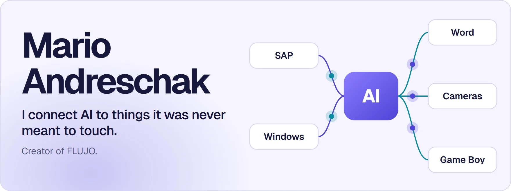</picture>

<a href="https://github.com/mario-andreschak/FLUJO">FLUJO</a> &nbsp;·&nbsp; <a href="https://flujo.com.co/">flujo.com.co</a> &nbsp;·&nbsp; <a href="https://discord.gg/KPyrjTSSat">Discord</a> &nbsp;·&nbsp; <a href="https://www.linkedin.com/in/mario-andreschak-674033299/">LinkedIn</a> &nbsp;·&nbsp; <a href="https://github.com/flujo-app">More projects on flujo-app</a>

 

<picture><source media="(prefers-color-scheme: dark)" srcset="assets/tiles/s-building-dark.webp">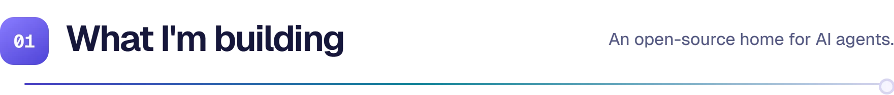</picture>

<table>
<tr><td width="50%" rowspan="2" valign="top"><a href="https://github.com/mario-andreschak/FLUJO"><picture><source media="(prefers-color-scheme: dark)" srcset="assets/tiles/flujo-dark.webp">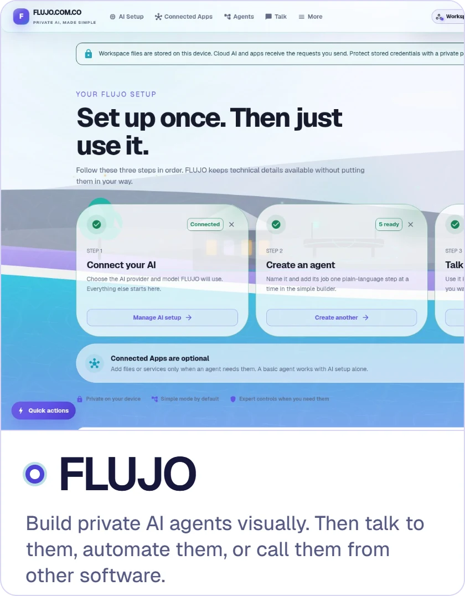</picture></a></td><td width="50%" valign="top"><a href="https://github.com/flujo-app/FACTORY"><picture><source media="(prefers-color-scheme: dark)" srcset="assets/tiles/factory-dark.webp">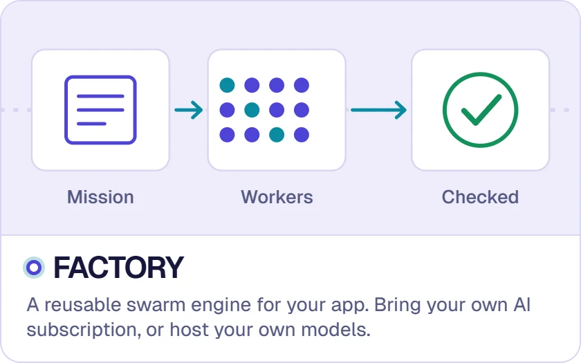</picture></a></td></tr>
<tr><td valign="top"><a href="https://github.com/flujo-app/brain"><picture><source media="(prefers-color-scheme: dark)" srcset="assets/tiles/brain-dark.webp">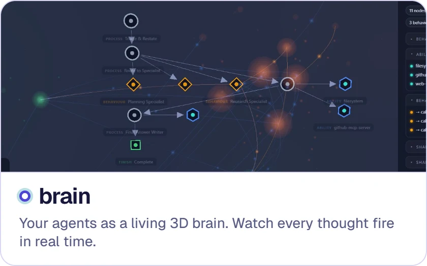</picture></a></td></tr>
</table>

 

<picture><source media="(prefers-color-scheme: dark)" srcset="assets/tiles/s-sap-dark.webp">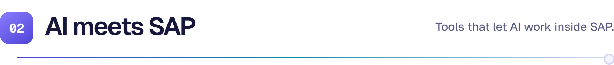</picture>

<table>
<tr><td width="33%" valign="top"><a href="https://github.com/mario-andreschak/mcp-abap-abap-adt-api"><picture><source media="(prefers-color-scheme: dark)" srcset="assets/tiles/abap-api-dark.webp">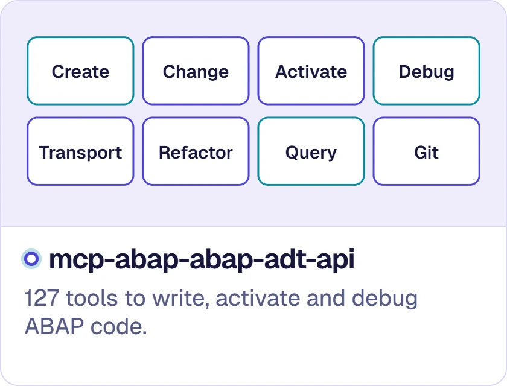</picture></a></td><td width="33%" valign="top"><a href="https://github.com/mario-andreschak/mcp-abap-adt"><picture><source media="(prefers-color-scheme: dark)" srcset="assets/tiles/abap-adt-dark.webp">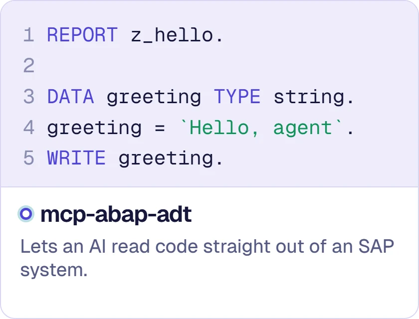</picture></a></td><td width="33%" valign="top"><a href="https://github.com/mario-andreschak/mcp-sap-gui"><picture><source media="(prefers-color-scheme: dark)" srcset="assets/tiles/sap-gui-dark.webp">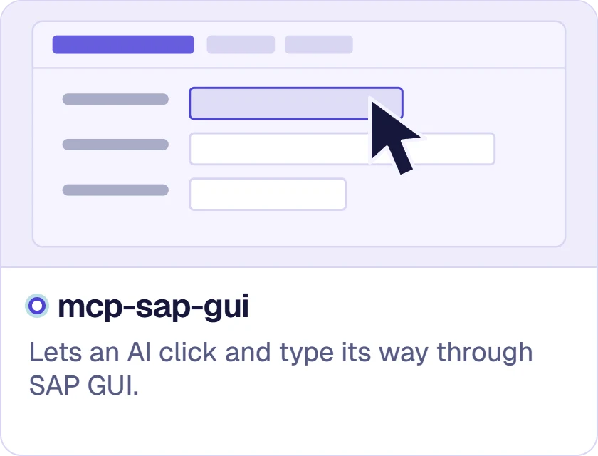</picture></a></td></tr>
<tr><td align="center"></td><td align="center"></td><td align="center"></td></tr>
</table>

 

<picture><source media="(prefers-color-scheme: dark)" srcset="assets/tiles/s-desktop-dark.webp">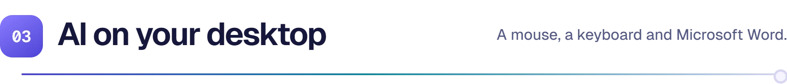</picture>

<table>
<tr><td width="33%" valign="top"><a href="https://github.com/mario-andreschak/mcp-windows-desktop-automation"><picture><source media="(prefers-color-scheme: dark)" srcset="assets/tiles/windows-automation-dark.webp">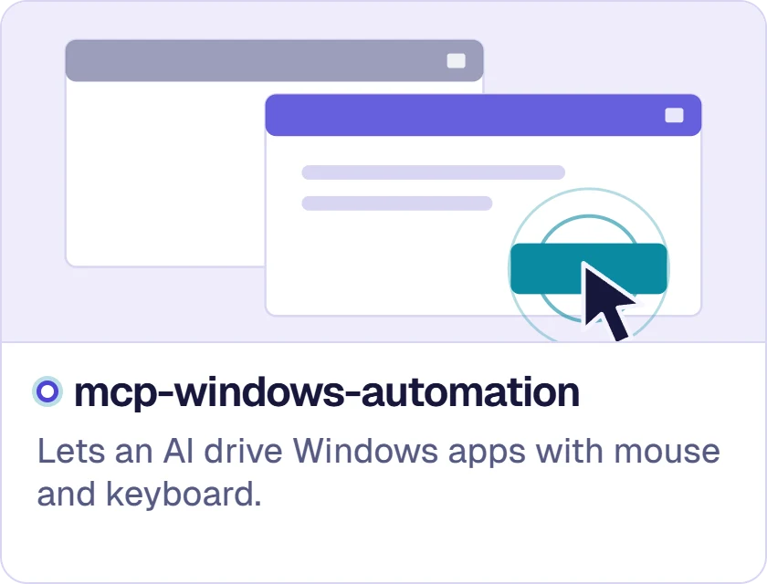</picture></a></td><td width="33%" valign="top"><a href="https://github.com/mario-andreschak/mcp-msoffice-interop-word"><picture><source media="(prefers-color-scheme: dark)" srcset="assets/tiles/word-dark.webp">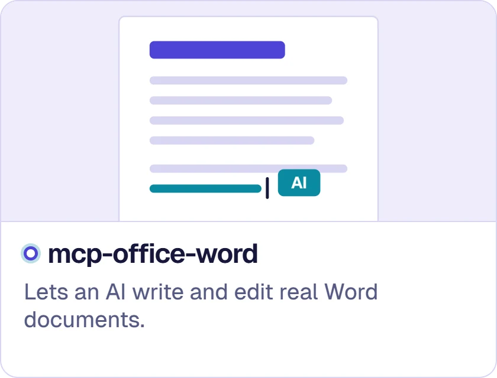</picture></a></td><td width="33%" valign="top"><a href="https://github.com/mario-andreschak/mcp-essentials-windows"><picture><source media="(prefers-color-scheme: dark)" srcset="assets/tiles/essentials-dark.webp">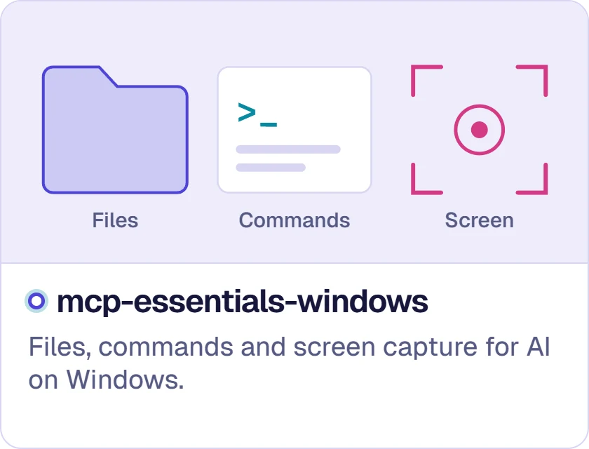</picture></a></td></tr>
<tr><td align="center"></td><td align="center"></td><td align="center"></td></tr>
</table>

 

<picture><source media="(prefers-color-scheme: dark)" srcset="assets/tiles/s-senses-dark.webp"></picture>

<table>
<tr><td width="50%" rowspan="2" valign="top"><a href="https://github.com/mario-andreschak/mcp-gameboy"><picture><source media="(prefers-color-scheme: dark)" srcset="assets/tiles/gameboy-dark.webp">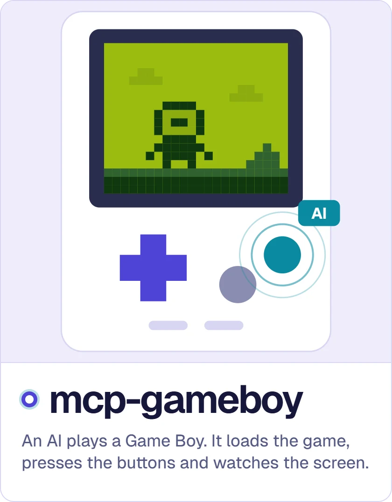</picture></a></td><td width="50%" valign="top"><a href="https://github.com/mario-andreschak/mcp-image-recognition"><picture><source media="(prefers-color-scheme: dark)" srcset="assets/tiles/image-recognition-dark.webp">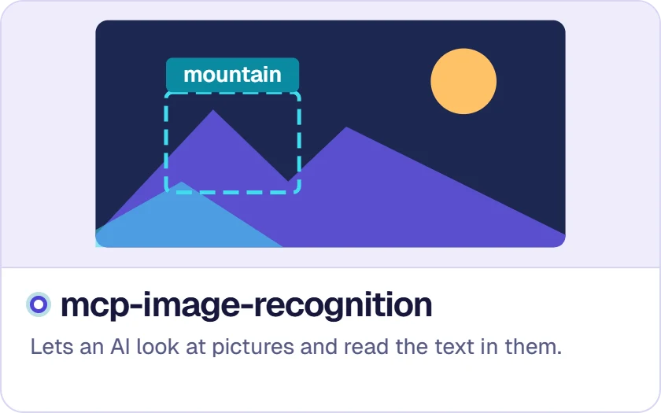</picture></a></td></tr>
<tr><td valign="top"><a href="https://github.com/mario-andreschak/mcp_video_recognition"><picture><source media="(prefers-color-scheme: dark)" srcset="assets/tiles/video-recognition-dark.webp">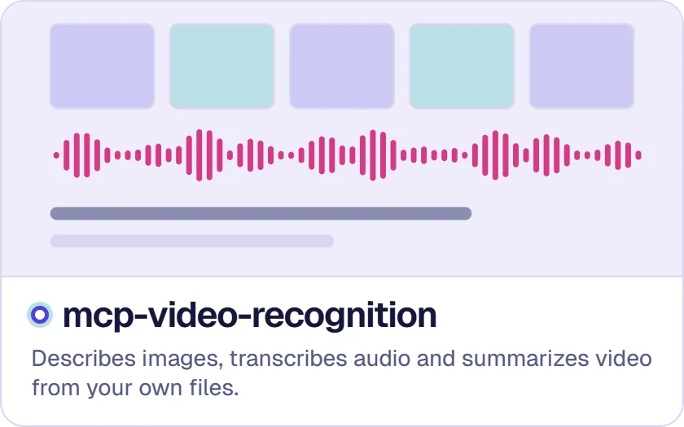</picture></a></td></tr>
</table>

 

<picture><source media="(prefers-color-scheme: dark)" srcset="assets/tiles/s-fun-dark.webp">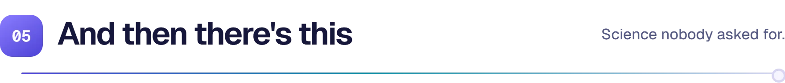</picture>

<a href="https://github.com/flujo-app/ai-fruit-fly"><picture><source media="(prefers-color-scheme: dark)" srcset="assets/tiles/fruit-fly-dark.webp">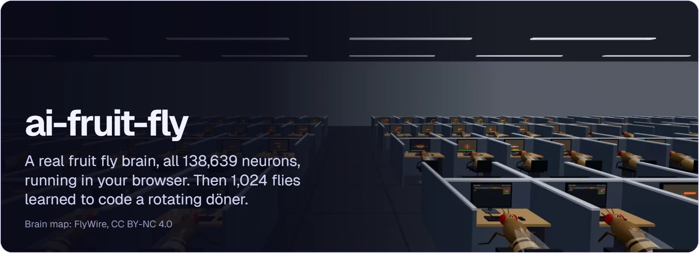</picture></a>

 

Also: <a href="https://github.com/mario-andreschak/mcp-veo2">mcp-veo2</a>, makes videos with Google Veo and images with Gemini · <a href="https://github.com/mario-andreschak/hotswap-mcp-bridge">hotswap-mcp-bridge</a>, swaps AI tools without dropping a request · <a href="https://github.com/mario-andreschak/docs-sap-abap-automated-documentation-prompts">docs-sap-abap</a>, prompts that write SAP documentation for you · <a href="https://github.com/mario-andreschak/factored-hackathon-2026-mcg">Savia</a>, our Factored Hackathon 2026 entry.
